<!-- Save this as README.md in a public repo named exactly "Varisha218" -->

> *Coding isn't just problem-solving, it's a canvas where critical thinking and artistry intersect.*

## `$ whoami`

## Experience

| Period | Role | Organisation |
|--------|------|--------------|
| Oct 2026 – Present | **Teaching Assistant** · Applications of Information & Communications Technology | Institute of Space Technology (IST) |
| Jul 2026 – Aug 2026 | **App Development Intern** · Flutter, Firebase, GitHub | Sysreforms International |
| Jul 2025 – Oct 2025 | **AI Intern** · Deepfake Detection, Hugging Face | Institute of Space Technology (IST) |
| Jul 2025 – Aug 2025 | **Intern** · Teaching & HR Support | Dr. AQ Khan School & College System |
| Jun 2022 – Jul 2022 | **Intern** | Green Valley |

## Education & Leadership

| 🎓 | Detail |
|---|--------|
| 🏛️ | **BS Computer Science** — Institute of Space Technology (IST), 2023 – 2027 |
| 📚 | **A-Levels** (Computer Science, Mathematics, Physics) — Future World, 2021 – 2023 |
| 🎖️ | **Scholarship Holder** — A-Levels, Future World |
| 💼 | **Vice President, Microsoft Society** — led tech events and activities |
| 🔐 | **Organised a cybersecurity workshop** with industry professionals for hands-on training |

## Featured Projects

| 🕒 **Attendance & Approvals App**   Flutter + Firebase (Auth & Firestore) app for employees and admins. Clock-in/out with location, break and project tracking, leave/WFH requests, attendance corrections, and a live **"Who is Where"** admin view with role-based management.   `Flutter` `Firebase` `Firestore` `GitHub` | 🕵️ **Deepfake Detection System**   Determines whether a person in an image or video is real or fake, using pre-trained **Hugging Face** models, with data preparation, accuracy testing and documented results.   `AI` `Hugging Face` `Computer Vision` |
|:--|:--|
| 🧩 [**Sudoku Game**](https://github.com/Varisha218/Sudoku-Game)   Console-based Sudoku in **C++** with an **SFML** graphical interface, 9x9 grid, auto-solve, input validation and board reset.   `C++` `SFML` `Algorithms` | 🏨 [**Hotel Reservation Website**](https://github.com/Varisha218/Hotel-Reservation-Website)   Browse and book rooms and suites, register/login, contact form, plus an **admin dashboard**.   `HTML` `CSS` `JavaScript` |
| 🏦 [**Bank Management System**](https://github.com/Varisha218/Bank-Management-System)   Console banking app in **C++**: accounts, transactions, withdrawals, with file-based persistence.   `C++` `File Handling` `OOP` | 🚦 [**Traffic Light using D Flip-Flops**](https://github.com/Varisha218/Traffic-light-using-D-Flip-Flops)   Digital traffic light built from D flip-flops, logic gates and a clock, simulating the green → yellow → red cycle.   `Digital Logic` `Flip-Flops` |

## Tech Stack

**Languages & Frameworks**

**AI / Backend**

**Tools**

## Technical Focus

### Mobile Development

### AI & Computer Vision

### Software Engineering

## Let's Connect

Open to **internships**, **app development**, and **AI/software engineering** opportunities.

